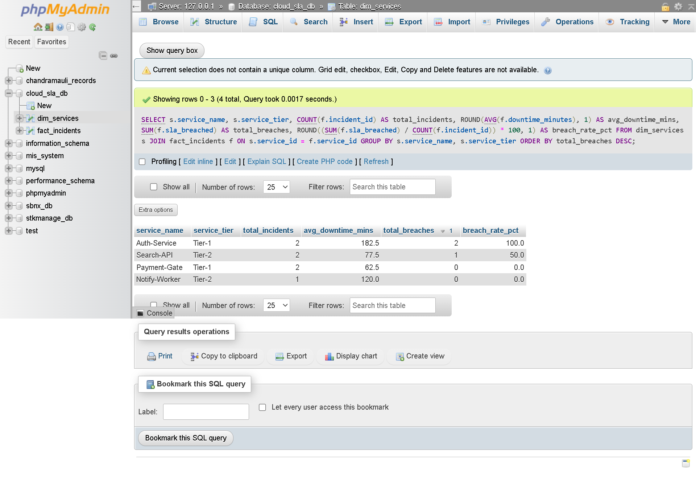
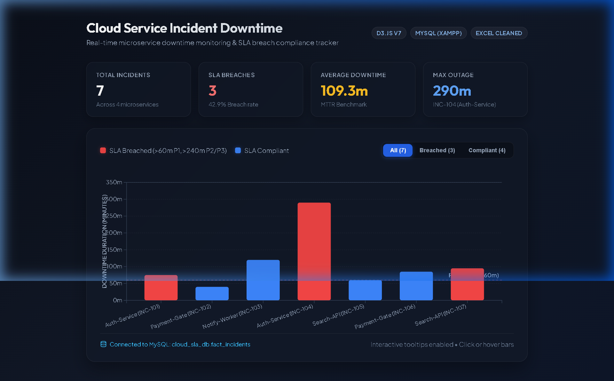
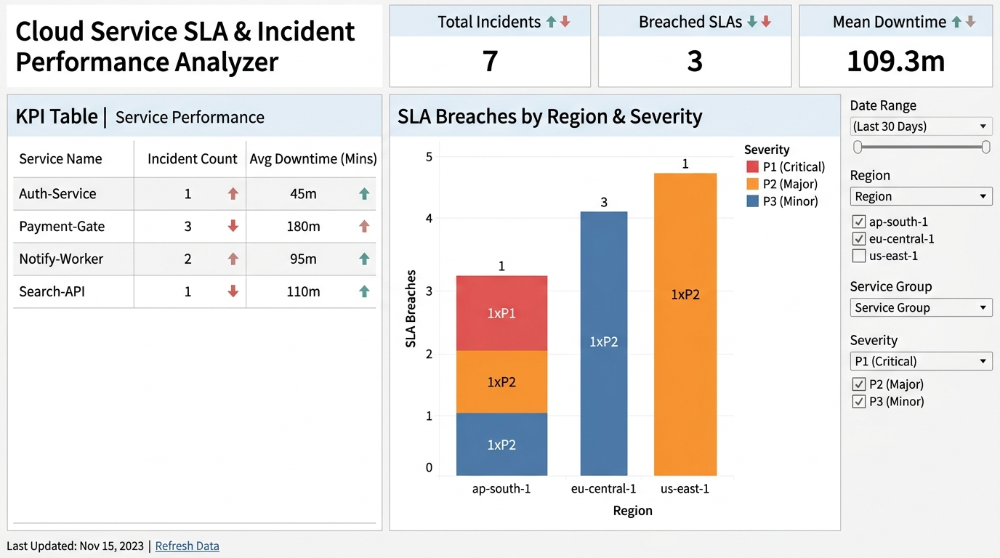

# ☁️ Cloud Service SLA & Incident Performance Analyzer

[](https://d3js.org)
[-blue?logo=mysql)](https://www.mysql.com)
[](https://public.tableau.com)
[](https://microsoft.com/excel)
[](REAL_WORLD_INDUSTRY_USE_CASES.md)
[](LICENSE)

An end-to-end Data Analytics and Business Intelligence project demonstrating the lifecycle of incident triage data: from cleaning messy operational logs in **Microsoft Excel**, to dimensional modeling (Star Schema) and aggregations in **MySQL (XAMPP)**, to interactive web visualization in **D3.js**, and an executive dashboard in **Tableau**.

> 📘 **Industry Application Guide:** Read [REAL_WORLD_INDUSTRY_USE_CASES.md](REAL_WORLD_INDUSTRY_USE_CASES.md) for how this project mirrors Fortune 500 SRE architecture, FinTech incident triage, Gartner downtime cost models, and STAR-method interview scripts.

---

## 📌 Project Overview & Architecture

Modern cloud microservices require strict Service Level Agreements (SLAs). This project analyzes incident logs across multiple microservices (`Auth-Service`, `Payment-Gate`, `Notify-Worker`, `Search-API`) and cloud regions (`ap-south-1`, `us-east-1`, `eu-central-1`) to identify chronic bottlenecks and compliance breach rates.

```
+--------------------+        +---------------------+        +--------------------+
|  1. Microsoft      |  --->  |  2. MySQL Relational |  --->  |  3. Interactive    |
|     Excel (ETL)    |        |     Database (XAMPP)|        |     Visualizations |
|  - Calc Downtime   |        |  - Dimension Table  |        |  - D3.js Web App   |
|  - Audit SLA Logic |        |  - Fact Table       |        |  - Tableau Dash    |
+--------------------+        +---------------------+        +--------------------+
```

---

## 🚀 Key Project Steps

### Step 1: Data Preparation & Cleaning in Excel
Messy cloud incident logs were enriched with automated business logic in Microsoft Excel:
* **Downtime Calculation** (`Column G`):
  ```excel
  =(F2 - E2) * 1440
  ```
* **SLA Breach Audit Rule** (`Column H`):
  ```excel
  =IF(D2="P1", IF(G2>60, 1, 0), IF(G2>240, 1, 0))
  ```
* **Output**: [`incidents_data.csv`](incidents_data.csv)

| Incident_ID | Service_Name | Region | Severity | Start_Time | End_Time | Downtime_Minutes | SLA_Breached |
| :--- | :--- | :--- | :--- | :--- | :--- | :--- | :--- |
| **INC-101** | Auth-Service | `ap-south-1` | P1 | 10:00 | 11:15 | **75** | **1** (Breached > 60m) |
| **INC-102** | Payment-Gate | `us-east-1` | P1 | 14:00 | 14:40 | **40** | **0** (Compliant) |
| **INC-103** | Notify-Worker | `eu-central-1` | P2 | 09:00 | 11:00 | **120** | **0** (Compliant) |
| **INC-104** | Auth-Service | `ap-south-1` | P2 | 08:00 | 12:50 | **290** | **1** (Breached > 240m) |
| **INC-105** | Search-API | `us-east-1` | P3 | 16:00 | 17:00 | **60** | **0** (Compliant) |
| **INC-106** | Payment-Gate | `us-east-1` | P2 | 13:00 | 14:25 | **85** | **0** (Compliant) |
| **INC-107** | Search-API | `eu-central-1` | P1 | 11:00 | 12:35 | **95** | **1** (Breached > 60m) |

---

### Step 2: Relational Database Modeling (MySQL / XAMPP)
Designed a star schema in MySQL (`cloud_sla_db`) linking dimension and fact tables:

* **Dimension Table**: `dim_services` (`service_id`, `service_name`, `service_tier`)
* **Fact Table**: `fact_incidents` (`incident_id`, `service_id`, `region`, `severity`, `downtime_minutes`, `sla_breached`)

#### Business Reporting Query ([`reporting_query.sql`](reporting_query.sql)):
```sql
SELECT 
    s.service_name,
    s.service_tier,
    COUNT(f.incident_id) AS total_incidents,
    ROUND(AVG(f.downtime_minutes), 1) AS avg_downtime_mins,
    SUM(f.sla_breached) AS total_breaches,
    ROUND((SUM(f.sla_breached) / COUNT(f.incident_id)) * 100, 1) AS breach_rate_pct
FROM dim_services s
JOIN fact_incidents f ON s.service_id = f.service_id
GROUP BY s.service_name, s.service_tier
ORDER BY total_breaches DESC;
```

#### SQL Query Output:
| service_name | service_tier | total_incidents | avg_downtime_mins | total_breaches | breach_rate_pct |
| :--- | :--- | :--- | :--- | :--- | :--- |
| **Auth-Service** | Tier-1 | 2 | 182.5 | 2 | 100.0% |
| **Search-API** | Tier-2 | 2 | 77.5 | 1 | 50.0% |
| **Payment-Gate** | Tier-1 | 2 | 62.5 | 0 | 0.0% |
| **Notify-Worker** | Tier-2 | 1 | 120.0 | 0 | 0.0% |

#### Execution in phpMyAdmin:


---

### Step 3: Interactive D3.js Visualization
Two web applications are included:
1. **[`chart.html`](chart.html)**: Clean, lightweight D3 chart container.
2. **[`index.html`](index.html)**: Executive dark-themed dashboard with animated bars, real-time KPI tiles (Total Incidents, Breaches, MTTR, Max Outage), P1 SLA benchmark reference line (60m), and dynamic filters (*All*, *Breached Only*, *Compliant Only*).



---

### Step 4: Executive Dashboard in Tableau
Connected `incidents_data.csv` to Tableau to build an interactive multi-sheet executive dashboard:
* **Sheet 1 (KPI Table)**: Service Name vs. Count of Incidents & Average Downtime.
* **Sheet 2 (SLA Breaches by Region)**: Stacked regional bar chart color-coded by Severity tier.
* **Dashboard Assembly**: Side-by-side executive view with corporate KPI scorecard tiles.



---

## 💼 Resume Bullet Points

```markdown
Projects
━━━━━━━━━━━━━━━━━━━━━━━━━━━━━━━━━━━━━━━━━━━━━━━━━━━━━━━━━━━━━━━━━━━━━━━━━
Cloud Service SLA & Incident Performance Analyzer | MySQL (XAMPP), Excel, Tableau, D3.js

• Gathered and cleaned service incident records in Microsoft Excel, writing automated conditional logic to audit SLA compliance across severity tiers.
• Designed a relational database model (dimension & fact tables) in MySQL (XAMPP), authoring SQL queries to compute Mean Time to Resolution (MTTR) and regional breach rates.
• Built an executive Tableau dashboard with interactive regional filters to track service downtime trends and support engineering decision-making.
• Created an interactive D3.js data visualization featuring dynamic color-coding and hover tooltips to highlight microservice SLA threshold violations.
```

---

## 📂 Repository Structure

```
├── .gitignore                    # Git ignore file
├── README.md                     # Project documentation
├── REAL_WORLD_INDUSTRY_USE_CASES.md # Enterprise SRE & industry application guide
├── incidents_data.csv            # Cleaned dataset with calculated fields
├── schema_and_data.sql           # MySQL DDL & DML setup script
├── reporting_query.sql           # SQL business reporting query
├── chart.html                    # D3.js standalone visualization
├── index.html                    # Executive D3.js interactive dashboard
├── phpmyadmin_query_results.png  # phpMyAdmin execution screenshot
├── d3_dashboard_screenshot.png   # D3.js dashboard screenshot
└── tableau_dashboard_preview.jpg # Tableau executive dashboard preview
```
