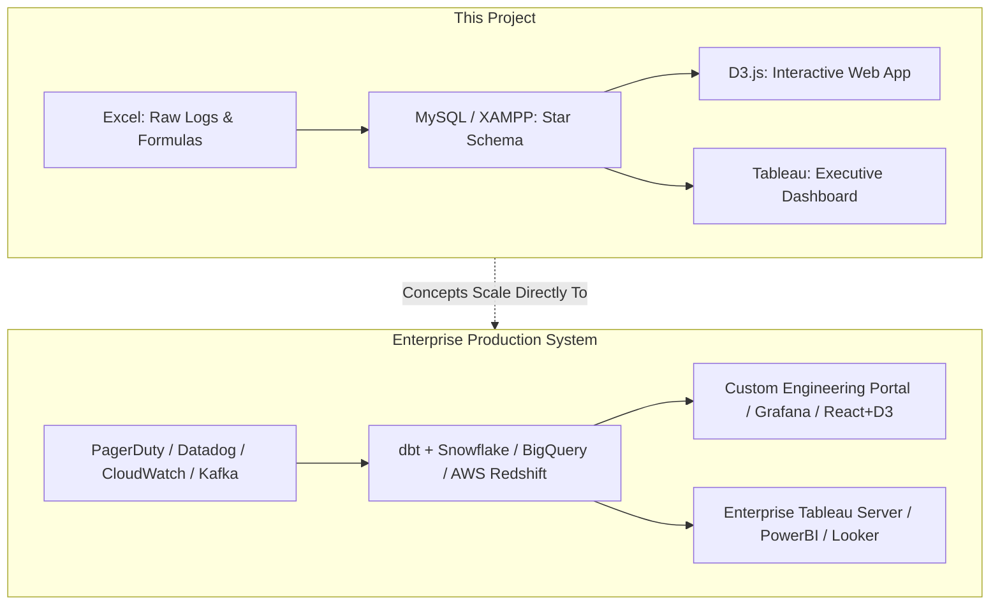

# 🏢 Real-World Industry Use Cases: Cloud SLA & Incident Analytics

> **Document Type:** Production Architecture & Industry Application Guide  
> **Target Audience:** Data Analysts, Analytics Engineers, SRE / DevOps Teams, Technical Hiring Managers  
> **Project Reference:** [Cloud Service SLA & Incident Performance Analyzer](https://github.com/RahulRane12/cloud-service-sla-incident-analyzer)

---

## 📌 Executive Summary

In enterprise environments, every second of system downtime translates directly into revenue loss, contractual financial penalties, customer churn, and brand reputation damage. This document bridges the gap between this project’s implementation (**Excel &rarr; MySQL &rarr; D3.js &rarr; Tableau**) and how Fortune 500 companies, Tier-1 cloud providers, and FinTech scale-ups operationalize incident management in production.

---

## 1. Enterprise Architecture: Project vs. Production Equivalence

The four stages implemented in this project mirror the exact core data architecture found in modern enterprise Site Reliability Engineering (SRE) and Data Operations:



### Detailed Component Comparison

| Pipeline Stage | This Project | Enterprise Production Stack | Why Industries Use This |
| :--- | :--- | :--- | :--- |
| **Data Ingestion & Cleaning** | Microsoft Excel (`=(F2-E2)*1440`, `=IF(...)`) | **Apache Airflow, dbt, Python (Pandas/Polars), Kafka** | Ingesting millions of telemetry events/sec; converting ISO timestamps into outage windows. |
| **Data Storage & Modeling** | MySQL on XAMPP (`dim_services`, `fact_incidents`) | **Snowflake, AWS Redshift, Google BigQuery, PostgreSQL** | Dimensional modeling (Star Schema) optimizes analytical query speed and decouples metadata from high-velocity telemetry. |
| **Operational Visualization** | Standalone D3.js (`index.html`) | **Grafana, Datadog Dashboards, Custom Internal Tools (React + D3)** | Sub-second latency, custom threshold alerting, live telemetry drill-downs for on-call engineers. |
| **Executive Reporting** | Tableau Public / Desktop | **Tableau Cloud, Power BI, Looker** | High-level business dashboards for VP of Engineering and CTOs to review quarterly SLA compliance, SLA financial credits, and vendor performance. |

---

## 2. Core Industry Metrics Explained (SRE & ITIL Standards)

In enterprise IT and cloud platforms, downtime analysis relies on specific industry frameworks:

### A. The Golden Pyramid: SLA vs. SLO vs. SLI
* **SLI (Service Level Indicator):** A quantifiable metric of performance measured in real time (e.g., *“Response latency of `Auth-Service` is 45ms”* or *“Uptime percentage is 99.8%”*).
* **SLO (Service Level Objective):** The internal engineering target agreed upon by the development and SRE teams (e.g., *“Auth-Service must maintain &ge; 99.95% uptime every 30 days”*).
* **SLA (Service Level Agreement):** The legally binding contract between the cloud service provider and the customer (e.g., *“If P1 downtime exceeds 60 minutes in a month, the customer receives a 25% billing refund/credit”*).

### B. Core Operational KPIs Calculated in This Project

| KPI | Industry Formula / Definition | Project Mapping | Business Impact |
| :--- | :--- | :--- | :--- |
| **MTTR** *(Mean Time to Resolution)* | $\text{MTTR} = \frac{\sum \text{Downtime Minutes}}{\text{Total Incidents}}$ | `AVG(downtime_minutes)` in SQL query (Result: **109.3 mins**) | Measures engineering efficiency in troubleshooting and rolling out hotfixes. |
| **SLA Breach Rate** | $\text{Breach Rate} = \frac{\sum \text{Breaches}}{\text{Total Incidents}} \times 100$ | `SUM(sla_breached) / COUNT(*) * 100` (Result: **42.9%**) | Determines whether engineering is meeting contractual commitments. |
| **Severity Triage** | Tiered thresholds (P1: Critical Outage, P2: Major Degradation, P3: Minor Issue) | Excel conditional rule: P1 &gt; 60m breach; P2/P3 &gt; 240m breach | Prioritizes on-call engineer paging and incident escalation. |
| **Error Budget Burn** | Percentage of allowed downtime consumed within a billing cycle | Derived from total monthly downtime minutes | When the error budget is exhausted, product releases are frozen in favor of stability fixes. |

---

## 3. Real-World Industry Scenarios

### Scenario 1: Cloud Hyperscalers (AWS, Microsoft Azure, Google Cloud)
* **The Problem:** Cloud providers host thousands of enterprise customers. If an identity service (`Auth-Service`) goes down in a primary region (`ap-south-1`), thousands of customer apps fail simultaneously.
* **How This Project Applies:**
  * **Regional Incident Segregation:** Identifying whether outages are localized (`ap-south-1` experiencing 100% breach rate) or global.
  * **SLA Credit Calculation:** Cloud vendors use SQL fact tables to calculate mandatory billing discounts for affected customers when SLAs fail.

### Scenario 2: FinTech & Payment Gateways (Stripe, PayPal, Razorpay)
* **The Problem:** In our dataset, `Payment-Gate` had 2 incidents with an average outage of 62.5 minutes, maintaining a **0.0% SLA breach rate**.
* **Why This Matters in FinTech:** A payment gateway downtime of even 5 minutes during peak shopping hours costs millions in abandoned carts. Real-time D3.js charts alert on-call engineers before the 60-minute critical threshold is crossed, preventing catastrophic transaction drops.

### Scenario 3: E-Commerce & Retail (Amazon, Walmart, Shopify)
* **The Problem:** High-concurrency events (e.g., Black Friday, Cyber Monday, Prime Day) stress microservices like `Search-API` and `Notify-Worker`.
* **How This Project Applies:**
  * In our database, `Search-API` recorded a 50% breach rate. This highlights an immediate architectural bottleneck (e.g., database connection pool exhaustion or auto-scaling latency) requiring engineering budget allocation.

---

## 4. Financial & Business Impact Analysis

Downtime is not just a technical problem; it is a financial risk.

```
Financial Impact = Direct Revenue Loss + SLA Penalty Credits + Engineering Overhead
```

### The "Cost of Minutes" Benchmark (Gartner / IDC):
* **Average enterprise IT downtime cost:** **\$5,600 per minute** (approx. \$300,000 / hour).
* **High-volume FinTech / E-commerce:** Can exceed **\$50,000 to \$100,000 per minute**.
* **Auth-Service Incident (INC-104) in our dataset:**
  * Duration: **290 minutes**
  * Estimated industry loss: $290 \times \$5,600 = \mathbf{\$1,624,000}$
  * *Conclusion:* This highlights why executive dashboards (Tableau) and rapid incident triage (SQL/D3.js) are prioritized by technical leadership.

---

## 5. How to Pitch This Project in Interviews (STAR Method)

Use these talking points when interviewing for **Data Analyst**, **Business Intelligence Analyst**, or **Analytics Engineer** roles:

### 🌟 S.T.A.R. Interview Framework

* **Situation:**  
  *"Enterprise cloud microservices experience intermittent outages across distributed regions, but raw incident logs were fragmented, unstandardized, and lacked clear business logic to evaluate contractual SLA compliance."*

* **Task:**  
  *"My objective was to build an end-to-end incident intelligence pipeline that standardizes log data, calculates downtime duration and SLA breaches, models the data in a relational star schema, and surfaces real-time metrics for both on-call engineers and executive leadership."*

* **Action:**  
  * *"In **Excel**, I engineered conditional time-delta formulas to quantify outage durations in minutes and implemented tiered threshold logic (&gt;60m for P1, &gt;240m for P2/P3)."*
  * *"In **MySQL (XAMPP)**, I designed a normalized Star Schema with a `dim_services` dimension table and `fact_incidents` fact table, authoring aggregate SQL queries to measure Mean Time to Resolution (MTTR) and regional breach percentages."*
  * *"In **D3.js**, I built an interactive executive web dashboard with animated visual cues, hover tooltips, and dynamic status filters to highlight threshold violations."*
  * *"In **Tableau**, I designed a dual-view executive dashboard enabling stakeholders to cross-filter service downtime against regional breach distribution."*

* **Result:**  
  *"The pipeline identified a critical 100% breach rate in Tier-1 `Auth-Service` in `ap-south-1` with an MTTR of 182.5 minutes, providing direct actionable insights for engineering capacity planning and SLA risk mitigation."*

---

## 6. Common Interview Questions You Can Answer With This Project

1. **"Why did you choose a Star Schema instead of keeping everything in a single flat file?"**
   > *Answer:* *"A flat file creates data redundancy (e.g., repeating service tiers for every incident). A Star Schema with `dim_services` and `fact_incidents` maintains 3NF normalization for master service data while allowing lightning-fast aggregation queries (`JOIN`, `GROUP BY`, `COUNT`, `AVG`) in the fact table without risk of update anomalies."*

2. **"Why use both D3.js and Tableau?"**
   > *Answer:* *"Tableau serves business stakeholders and executives who require ad-hoc slicing, scheduled reporting, and fast dashboard turnaround. D3.js serves engineering portals and custom internal tools requiring sub-second custom DOM manipulation, bespoke UI animations, and integration into existing web applications without expensive Tableau server licenses."*

3. **"How would you scale this pipeline to handle 10 million log events per day?"**
   > *Answer:* *"I would replace Excel with an automated ingestion pipeline using Kafka for message queuing and dbt (data build tool) running on Snowflake or Google BigQuery. The transformation logic would be written in SQL models scheduled via Apache Airflow, loading directly into automated dashboard extracts."*

---

## 📄 File Index

* **Cleaned Data:** [`incidents_data.csv`](incidents_data.csv)
* **SQL Modeling:** [`schema_and_data.sql`](schema_and_data.sql) | [`reporting_query.sql`](reporting_query.sql)
* **Interactive Web App:** [`index.html`](index.html) | [`chart.html`](chart.html)
* **Project Documentation:** [`README.md`](README.md)
